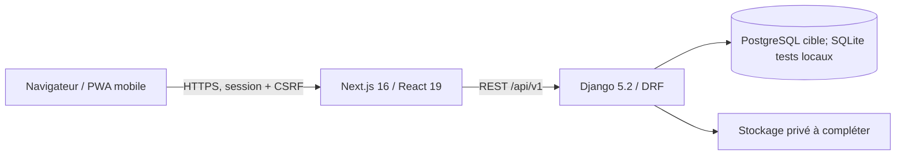

# Architecture — Mon Carnet Numérique

**État revu : 13/10/2026.** V1 en construction, non autorisée pour des données de santé réelles. Pour les preuves datées, voir [l’état réel V1](ETAT-REEL-V1.md) ; la roadmap porte les décisions produit.

## Vue technique actuelle

Monorepo : `apps/web` (Next.js App Router), `apps/api` (Django modulaire), `packages/ui` (tokens/thèmes), `docs/`, scripts `ops/`. Sessions serveur; cookies sécurisés hors DEBUG; aucun jeton JWT en `localStorage`. Les services Docker Compose sont pour le développement, pas une configuration production.

## Modèle d’identité et d’accès cible

- **Compte utilisateur unique** : identifiants e-mail/mot de passe et identités fournisseurs Google/Facebook/Apple dans `AuthIdentity`. La liaison doit être explicite après authentification; email identique seul ne fusionne pas les comptes.
- **Étape 1** : prénom, nom, avatar éditable; préremplissage du fournisseur possible.
- **Étape 2** : Patient ou Professionnel. Aucun choix public Root/Établissement.
- **Étape 3** : profil du contexte choisi.
- **Étape 4** : question et réponse secrète de récupération configurées sur le compte. La réponse est hachée côté serveur; ce mécanisme complémentaire ne permet pas, seul, de récupérer le compte ou d’accéder aux données cliniques.
- **Patient** : possède le carnet et accorde/refuse les AccessGrants.
- **Enfant représenté** : dossier `PatientProfile` séparé, lié au compte du parent par `PatientRepresentation`. Le profil et ses déclarations ne sont ni fusionnés avec le dossier du parent ni supprimés lors d’une révocation. L’API résout le profil sélectionné côté serveur et journalise l’accès représenté. La création est limitée aux enfants déclarés mineurs; l’adulte représenté doit consentir lui-même à toute délégation, parcours non activé.
- **Transfert à l’âge adulte** : le titulaire demande le transfert depuis son propre compte avant de créer un dossier patient distinct. Le transfert conserve l’UUID du dossier et ses relations cliniques. L’approbation staff exige une vérification manuelle de l’âge et de l’identité; le seuil `ECARNET_REPRESENTATION_LEGAL_AGE` reste à configurer après validation juridique. La file de revue est réservée aux superutilisateurs; aucune pièce d’identité n’est collectée par l’application.
- **Carte d’urgence hors ligne** : document distinct de la carte QR publique et de l’AccessGrant. L’export privé ne contient que l’identité minimale, les allergies/traitements sélectionnés, le contact d’urgence et les dates. Les impressions et PDF hors ligne ne peuvent être expirés ou effacés à distance; les exports sont journalisés.
- **Professionnel** : médecin avec compte propre. Les justificatifs professionnels ne sont pas collectés par E‑Carnet; l’établissement effectue sa vérification interne. Une demande de rattachement active après approbation établissement. Le professionnel accède uniquement au dossier du cas qui lui est attribué, selon le périmètre et la durée de l’autorisation patient active.
- **Établissement** : espace privé avec compte d’un administrateur nominatif, un seul actif en V1. L’entité établissement est indépendante de l’admin, qui peut être remplacé sans recréer l’entité. L’administrateur actif consulte les dossiers qui comportent une pré-consultation clôturée ou une consultation dans sa structure; les enregistrements d’autres établissements ne sont pas ouverts automatiquement. Pas de rôle global `root`.
- **Startup E‑Carnet** : vérification manuelle des preuves structure reçues par e-mail puis création de l’accès depuis une console staff privée. L’invitation nominative est unique, expire à 48 h et laisse le destinataire choisir son mot de passe.

### Matrice d’accès aux dossiers

| Rôle | Accès autorisé | Limite |
|---|---|---|
| Administrateur actif d’un établissement | Dossiers avec une pré-consultation clôturée ou une consultation associée à son établissement. | Pas d’accès automatique aux dossiers associés à un autre établissement. |
| Professionnel | Dossier du cas attribué au professionnel par son autorisation, pour les périmètres et la durée acceptés par le patient. | Rattachement et établissement actifs; autorisation patient active; pas d’accès aux cas d’un autre professionnel ou d’un autre établissement. |
| Administrateur d’un autre établissement / tiers | Aucun accès par simple appartenance à sa structure. | Un accès distinct et explicitement autorisé est requis; aucune ouverture automatique de données inter-établissements. |

### Cible V3 — continuité inter-établissements (non implémentée)

Lors d’une prise en charge à l’établissement B, un professionnel authentifié et activement rattaché à B pourra demander, avec preuve d’identité patient et consentement granulaire, un accès limité à certaines données antérieures d’un dossier patient. Le dossier maître reste celui du patient. Une éventuelle copie de suivi versée au dossier de B est horodatée, attribuée et en lecture seule; correction par addendum, jamais par édition de l’original. L’accès de l’administrateur de B reste limité aux dossiers associés à B et ne donne aucun accès automatique aux données de l’établissement A. Révocation/expiration bloque l’accès professionnel futur sans effacer les copies institutionnelles déjà soumises à des règles de conservation. Ce besoin V3 reste conditionné à une revue juridique, à un modèle de consentement et à l’analyse de sécurité. Détails dans [FLOW-ETABLISSEMENT.md](FLOW-ETABLISSEMENT.md) et la [roadmap produit V1–V5](ROADMAP-V1-V5.md).

Le code courant implémente ces frontières : route publique neutralisée, console staff, administrateur nominatif historisé, invitation hashée à usage unique/48 h envoyée par SMTP configurable, code médecin hashé à usage unique/48 h, demande en attente puis décision d’établissement. L’API ne renvoie pas le jeton d’invitation. La suite PostgreSQL 16 locale et un smoke de restauration isolée ont réussi le 08/10 ; SMTP de staging, instance managée, RPO/RTO et recette finale restent à faire. Voir [flow](FLOW-ETABLISSEMENT.md), [ADR-002](adr/ADR-002-etablissement-invitation-et-rattachement.md) et [preuves de recette](RECETTE-V1.md).

## Modules backend principaux

`identity` (compte, sessions, OAuth, thème), `patients`, `establishments`, `professionals`, `care` (pré-consultation, AccessGrant, QR, consultation), `audit`, `health`. L’API contrôle les droits; les IDs reçus du navigateur ne remplacent pas le contexte serveur. L’identifiant public du compte est un UUID; la clé Django entière reste interne.

## Sécurité et état d’implémentation

- Argon2id configuré en premier hasher; à recetter sur comptes anciens et staging.
- Question de récupération enregistrée dans le profil du compte; seul son état de configuration est exposé à l’API. Aucun parcours de récupération autonome n’est activé et le dossier patient n’est pas modifié.
- OAuth callbacks/identités uniques, retour UI, écran de liaison/déliaison et audit présents ; credentials et essais bout en bout avec les fournisseurs restent à faire.
- QR backend et écrans de génération/scan présents : jeton opaque hashé, usage unique, 300 s (5 minutes). Le formulaire professionnel requiert encore l’UUID patient séparément du jeton.
- Scopes AccessGrant : `preconsultation`, `declarations`, `consultations`; défaut `[preconsultation, declarations]`; `documents` est hors V1 (A9 décidé). Toute lecture clinique d'un professionnel passe par `care.services.require_scope(grant, scope)` (autorisation active **et** périmètre accordé) ; un test interdit les contrôles de périmètre écrits à la main. Aujourd'hui seul `preconsultation` est lu : `declarations` et `consultations` n'ont pas encore d'endpoint.
- Pré‑consultation : brouillon du patient (ou de la personne qui l'aide sur son téléphone), sans établissement, un seul à la fois. Le médecin lit le dernier brouillon grâce au QR ; **la signature de sa consultation clôture le brouillon** et le rattache à son établissement (transaction unique). Le patient ne clôture jamais.
- Carte d'urgence : QR unique et statique (jeton signé `carte.version.signature`, version figée), activable/désactivable ; ville et contact d'urgence sont des déclarations du carnet (`city`, `emergency_contact`, une valeur active à la fois) lues en direct par la carte publique. Les colonnes `city`, `contact_name`, `contact_phone` et `offline_declaration_ids` de `PatientEmergencyCard` sont héritées et à retirer dans une migration ultérieure.
- Récupération de compte : **la réponse à la question secrète suffit à choisir un nouveau mot de passe** (décision produit, en attendant l'OTP qui viendra la confirmer : point d'extension unique `identity.recovery.verify_recovery_proof`). `POST identity/recovery/question/` renvoie la vraie question ou un leurre stable (jamais de différence visible entre adresse inconnue, compte sans question, compte d'équipe ou inactif) ; `POST identity/recovery/reset/` vérifie la réponse (même normalisation qu'à l'enregistrement, faux hachage pour égaliser le temps), verrouille durablement le compte tous les 5 échecs (15 min, 30 min, 1 h… 24 h max, même message d'échec), exclut `is_staff`/`is_superuser`, ferme les autres sessions (le hachage d'authentification de session change), journalise `account.password_reset_by_recovery` / `account.recovery_locked` et envoie un e-mail d'alerte au titulaire. Limites : `ECARNET_RATE_RECOVERY` (12/h par IP) et `ECARNET_RATE_RECOVERY_EMAIL` (8/h par adresse). Faiblesse connue : une question personnalisée (hors des 3 proposées) distingue un vrai compte d'un leurre. Dernier recours si la réponse est perdue : demande à l'équipe par la boîte de contact (préfixe `[Récupération de compte]`).
- Attestation : parse XML, allowlist stricte, hash et date ; tests adversariaux intégrés.
- TOTP/MFA : V3; les endpoints et le stockage des secrets ont été retirés de la V1.
- AccessGrant : cibles non nulles et unicité des demandes en cours en base; expiration pending après 7 jours et délai de 30 jours après refus.
- Audit append-only/trigger (UPDATE/DELETE/TRUNCATE) et verrous de concurrence présents ; la recette sur la base cible et les privilèges DB restent à vérifier.
- Flow invitation/code médecin et UI correspondantes présents ; transport SMTP configurable et jeton d’invitation jamais renvoyé par l’API.
- Les pièces de la structure sont vérifiées hors application; les documents personnels du médecin ne sont pas stockés par E‑Carnet. La politique de conservation de la boîte e-mail officielle reste à définir. Le médecin accepte les conditions versionnées avant consommation du code; l’établissement ou le médecin peut terminer un rattachement sans supprimer son historique.

## Direction UI

Les prototypes HTML (320×660 environ) sont des références de **design**, non des références de flows. Reprendre l’expérience mobile générale : navigation compacte, hiérarchie, densité, proportions, cartes et icônes cohérentes. Le front utilise encore certains glyphes Unicode comme icônes; le travail d’alignement mobile est à faire. Ne pas recopier les parcours obsolètes.

## Résultats de vérification locale

Le 08/10/2026 : 77 tests Django réussis sur PostgreSQL 16 local (rapport reproductible) et smoke de restauration isolée réussi ; la durée observée d’une commande (1 s) n’est pas un RTO. Le 13/10, le build Next.js, le lint (sans erreur, 4 avertissements) et 12 tests Django ciblés identité sont passés; la suite web complète a des échecs dus à des chemins Windows mal construits. Staging, PostgreSQL managé, RPO/RTO, Android/4G et validations métier restent non démontrés. Voir [état réel](ETAT-REEL-V1.md), [sécurité](SECURITY.md) et [roadmap](ROADMAP-V1-V5.md).
