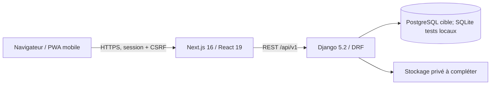

# Architecture — Mon Carnet Numérique

**État revu : 13/10/2026.** V1 en construction, non autorisée pour des données de santé réelles. Pour les preuves datées, voir [l’état réel V1](ETAT-REEL-V1.md) ; la roadmap porte les décisions produit.

## Vue technique actuelle

Monorepo : `apps/web` (Next.js App Router), `apps/api` (Django modulaire), `packages/ui` (tokens/thèmes), `docs/`, scripts `ops/`. Sessions serveur; cookies sécurisés hors DEBUG; aucun jeton JWT en `localStorage`. Les services Docker Compose sont pour le développement, pas une configuration production.

## Modèle d’identité et d’accès cible

- **Compte utilisateur unique** : identifiants e-mail/mot de passe et identités fournisseurs Google/Facebook/Apple dans `AuthIdentity`. La liaison doit être explicite après authentification; email identique seul ne fusionne pas les comptes.
- **Étape 1** : prénom, nom, avatar éditable; préremplissage du fournisseur possible.
- **Étape 2** : Patient ou Professionnel. Aucun choix public Root/Établissement.
- **Étape 3** : profil du contexte choisi.
- **Étape 4** : question et réponse secrète de récupération configurées sur le compte. La réponse est hachée côté serveur; ce mécanisme complémentaire ne permet pas, seul, de récupérer le compte ou d’accéder aux données cliniques.
- **Patient** : possède le carnet et accorde/refuse les AccessGrants.
- **Professionnel** : médecin avec compte propre. Les justificatifs professionnels ne sont pas collectés par E‑Carnet; l’établissement effectue sa vérification interne. Une demande de rattachement active après approbation établissement, et le médecin n’accède aux dossiers qu’avec consentement patient.
- **Établissement** : espace privé avec compte d’un administrateur nominatif, un seul actif en V1. L’entité établissement est indépendante de l’admin, qui peut être remplacé sans recréer l’entité. Pas de rôle global `root` et aucun accès clinique établissement.
- **Startup E‑Carnet** : vérification manuelle des preuves structure reçues par e-mail puis création de l’accès depuis une console staff privée. L’invitation nominative est unique, expire à 48 h et laisse le destinataire choisir son mot de passe.

Le code courant implémente ces frontières : route publique neutralisée, console staff, administrateur nominatif historisé, invitation hashée à usage unique/48 h envoyée par SMTP configurable, code médecin hashé à usage unique/48 h, demande en attente puis décision d’établissement. L’API ne renvoie pas le jeton d’invitation. La suite PostgreSQL 16 locale et un smoke de restauration isolée ont réussi le 08/10 ; SMTP de staging, instance managée, RPO/RTO et recette finale restent à faire. Voir [flow](FLOW-ETABLISSEMENT.md), [ADR-002](adr/ADR-002-etablissement-invitation-et-rattachement.md) et [preuves de recette](RECETTE-V1.md).

## Modules backend principaux

`identity` (compte, sessions, OAuth, thème), `patients`, `establishments`, `professionals`, `care` (pré-consultation, AccessGrant, QR, consultation), `audit`, `health`. L’API contrôle les droits; les IDs reçus du navigateur ne remplacent pas le contexte serveur. L’identifiant public du compte est un UUID; la clé Django entière reste interne.

## Sécurité et état d’implémentation

- Argon2id configuré en premier hasher; à recetter sur comptes anciens et staging.
- Question de récupération enregistrée dans le profil du compte; seul son état de configuration est exposé à l’API. Aucun parcours de récupération autonome n’est activé et le dossier patient n’est pas modifié.
- OAuth callbacks/identités uniques, retour UI, écran de liaison/déliaison et audit présents ; credentials et essais bout en bout avec les fournisseurs restent à faire.
- QR backend et écrans de génération/scan présents : jeton opaque hashé, usage unique, 300 s (5 minutes). Le formulaire professionnel requiert encore l’UUID patient séparément du jeton.
- Scopes AccessGrant : `preconsultation`, `declarations`, `consultations`; défaut `[preconsultation, declarations]`; `documents` est hors V1 (A9 décidé).
- Attestation : parse XML, allowlist stricte, hash et date ; tests adversariaux intégrés.
- TOTP/MFA : V3; les endpoints et le stockage des secrets ont été retirés de la V1.
- AccessGrant : cibles non nulles et unicité des demandes en cours en base; expiration pending après 7 jours et délai de 30 jours après refus.
- Audit append-only/trigger (UPDATE/DELETE/TRUNCATE) et verrous de concurrence présents ; la recette sur la base cible et les privilèges DB restent à vérifier.
- Flow invitation/code médecin et UI correspondantes présents ; transport SMTP configurable et jeton d’invitation jamais renvoyé par l’API.
- Les pièces de la structure sont vérifiées hors application; les documents personnels du médecin ne sont pas stockés par E‑Carnet. La politique de conservation de la boîte e-mail officielle reste à définir. Le médecin accepte les conditions versionnées avant consommation du code; l’établissement ou le médecin peut terminer un rattachement sans supprimer son historique.

## Direction UI

Les prototypes HTML (320×660 environ) sont des références de **design**, non des références de flows. Reprendre l’expérience mobile générale : navigation compacte, hiérarchie, densité, proportions, cartes et icônes cohérentes. Le front utilise encore certains glyphes Unicode comme icônes; le travail d’alignement mobile est à faire. Ne pas recopier les parcours obsolètes.

## Résultats de vérification locale

Le 08/10/2026 : 77 tests Django réussis sur PostgreSQL 16 local (rapport reproductible) et smoke de restauration isolée réussi ; la durée observée d’une commande (1 s) n’est pas un RTO. Le 13/10, le build Next.js, le lint (sans erreur, 4 avertissements) et 12 tests Django ciblés identité sont passés; la suite web complète a des échecs dus à des chemins Windows mal construits. Staging, PostgreSQL managé, RPO/RTO, Android/4G et validations métier restent non démontrés. Voir [état réel](ETAT-REEL-V1.md), [sécurité](SECURITY.md) et [roadmap](ROADMAP-V1-V5.md).
